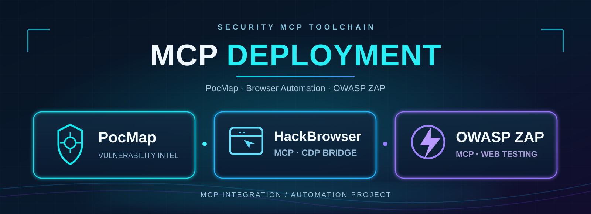

  
   
   
  

# MCP Deployment

**PocMap · HackBrowser MCP · OWASP ZAP MCP를 통합하는 보안 도구 서버 배포 프로젝트**

Ubuntu/Debian용 MCP 재설치 패키지이며, Python MCP 서버·Chromium CDP·ZAP·인증 게이트웨이를 구성합니다. GitHub Actions를 이용한 소스 자동 검사는 추가됐고, **ARM64 Docker 이미지 빌드 → GHCR → OCI 자동 배포는 다음 단계**입니다.

## 제공하는 MCP 서버

| MCP | 역할 | 예상 도구 수 | 서버 내부 주소 |
|---|---|---:|---|
| **PocMap** | CVE/취약점 조사, PoC·익스플로잇 정보, 위협 인텔리전스 | 22개 | 127.0.0.1:9000/mcp |
| **HackBrowser MCP** | Chromium CDP를 통한 웹페이지 탐색·입력·클릭·스크린샷 | 8개 | 127.0.0.1:8765/mcp |
| **OWASP ZAP MCP** | 웹 스파이더·능동/수동 검사·HTTP 기록·보고서 | 17개 | 127.0.0.1:8282 |

> 도구 수는 패키지의 검사 스크립트가 기대하는 값(**총 47개**)이며, 설치한 외부 MCP 버전에 따라 달라질 수 있습니다. 실제 등록 여부는 설치 후 상태 검사를 수행해야 확인됩니다. 여기서 HackBrowser MCP는 **구형 Electron 브라우저가 아니라 Chromium + Python CDP 브리지**입니다.

### HackBrowser MCP — 도구 8개

| 도구 | 기능 |
|---|---|
| <code>browser_status</code> | Chromium CDP 연결 상태 확인 |
| <code>browser_tabs</code> | 열린 탭/웹뷰 목록 조회 |
| <code>browser_navigate</code> | URL로 이동 |
| <code>browser_page_text</code> | 현재 페이지의 제목·텍스트 조회 |
| <code>browser_elements</code> | 링크 및 입력 요소 목록 조회 |
| <code>browser_click</code> | CSS 선택자로 요소 클릭 |
| <code>browser_fill</code> | 입력 요소에 문자열 입력 |
| <code>browser_screenshot</code> | 현재 페이지 스크린샷 파일 저장 |

<b>PocMap — 도구 22개 전체 보기</b>

| 도구 | 역할 |
|---|---|
| <code>lookup_cve</code> | CVE 상세 정보 |
| <code>cve_to_cpe</code> | CVE → CPE 변환 |
| <code>cpe_to_cve</code> | CPE → CVE 조회 |
| <code>discover_product_cves</code> | 제품·버전별 CVE 검색 |
| <code>discover_package_cves</code> | 패키지·의존성 취약점 조사 |
| <code>get_epss_score</code> | EPSS 악용 가능성 점수 |
| <code>check_kev_status</code> | CISA KEV 포함 여부 |
| <code>get_attack_techniques</code> | MITRE ATT&CK 연관 기법 |
| <code>find_github_pocs</code> | GitHub PoC 찾기 |
| <code>verify_github_pocs</code> | PoC 저장소 실제 내용 검증 |
| <code>find_metasploit_module</code> | Metasploit 모듈 검색 |
| <code>find_exploitdb_entry</code> | ExploitDB 검색 |
| <code>find_nuclei_template</code> | Nuclei 템플릿 검색 |
| <code>find_vulhub_docker</code> | Vulhub 실습 환경 검색 |
| <code>find_practice_labs</code> | 학습용 취약 환경 검색 |
| <code>find_bug_bounty_reports</code> | 버그바운티 보고서 검색 |
| <code>find_recent_exploits</code> | 최근 공개 익스플로잇 조사 |
| <code>get_cve_assessment_playbook</code> | CVE 평가 절차 |
| <code>get_rapid_response_playbook</code> | 긴급 취약점 대응 절차 |
| <code>get_bug_bounty_playbook</code> | 버그바운티 진행 절차 |
| <code>generate_json_report</code> | JSON 형식 취약점 분석 보고 |
| <code>generate_html_report</code> | HTML 형식 취약점 분석 보고 |

PocMap은 패키지에 소스가 포함되지 않습니다. 설치기는 PyPI의 <code>pocmap[server]==2.9.1</code>을 설치합니다. 위 기능의 실제 제공 여부는 설치 버전과 서버 설정으로 확인하세요.

<b>OWASP ZAP MCP — 도구 17개 전체 보기</b>

| 도구 | 역할 |
|---|---|
| <code>zap_info</code> | 서버 정보 |
| <code>zap_version</code> | ZAP 버전 |
| <code>zap_create_context</code> | 검사 컨텍스트 생성 |
| <code>zap_start_spider</code> | Spider 시작 |
| <code>zap_get_spider_status</code> | Spider 진행 상황 |
| <code>zap_stop_spider</code> | Spider 중지 |
| <code>zap_start_ajax_spider</code> | AJAX Spider 시작 |
| <code>zap_get_ajax_spider_status</code> | AJAX Spider 진행 상황 |
| <code>zap_stop_ajax_spider</code> | AJAX Spider 중지 |
| <code>zap_start_active_scan</code> | 능동 검사 시작 |
| <code>zap_get_active_scan_status</code> | 능동 검사 진행 상황 |
| <code>zap_stop_active_scan</code> | 능동 검사 중지 |
| <code>zap_get_passive_scan_status</code> | 수동 검사 큐 상태 |
| <code>zap_get_history</code> | HTTP 요청·응답 이력 조회 |
| <code>zap_list_resources</code> | ZAP MCP 리소스 목록 |
| <code>zap_read_resource</code> | ZAP MCP 리소스 읽기 |
| <code>zap_generate_report</code> | 검사 보고서 생성 |

## 구성

~~~text
AI / MCP 클라이언트
        │
   HTTPS · Caddy
        │
  공유 토큰 / Keycloak OAuth (선택)
        │
        ├── PocMap MCP           (Python)
        ├── HackBrowser MCP      (Python ↔ Chromium CDP)
        └── OWASP ZAP MCP        (Docker + ZAP addon)
~~~

- **PocMap·HackBrowser·게이트웨이:** Ubuntu 호스트의 systemd 서비스로 실행
- **ZAP·Caddy:** Docker Compose로 실행
- **Keycloak·PostgreSQL:** OAuth 모드에서 선택적으로 Docker 실행

**현재 패키지는 전체가 Docker로 컨테이너화된 구조가 아닙니다.** 기존 <code>MCP-Deployment/docker-compose.yml</code>만 실행해도 모든 MCP가 구동되는 것은 아닙니다.

## 설치 방법

### 1. 저장소 복제

Ubuntu/Debian **systemd 호스트**에서 실행합니다.

~~~bash
git clone https://github.com/Gandalem/hackbrowser.git
cd hackbrowser/MCP-Deployment
~~~

**사전 조건:** sudo 권한, 인터넷, Python 3, Docker/Compose 사용 가능 환경, 충분한 메모리 및 저장 공간. 현재 설치 프로그램은 Ubuntu/Debian 호스트용이며 Windows 또는 컨테이너 내부 설치를 지원하지 않습니다.

> **ARM64/OCI 주의:** 현재 OCI Ubuntu 22.04 ARM64에서 Docker 실행은 확인했지만, 이 통합 <code>install.sh</code>가 처음부터 끝까지 정상 작동하는지는 아직 검증하지 않았습니다. ARM64에서는 Chromium 패키지 설치 방식이 다를 수 있습니다. 아래 명령은 패키지에 구현된 설치 방법이며 OCI 배포 성공 기록이 아닙니다.

### 2-A. 로컬/테스트용 설치 (도메인 없음)

~~~bash
sudo PUBLIC_BASE_URL=http://127.0.0.1:8088 \
  CADDY_MODE=local ENABLE_OAUTH=0 SHARE_DAYS=7 \
  bash install.sh
~~~

로컬 모드는 해당 서버에서 접근하는 용도입니다. 원격 ChatGPT 연결에는 인증된 HTTPS 엔드포인트 또는 적절한 터널이 필요합니다.

### 2-B. 외부 HTTPS + OAuth 설치 (도메인 필요)

실제 DNS 이름으로 교체하고 TCP 80/443, 인증서 발급 가능 여부를 먼저 확인합니다.

~~~bash
sudo PUBLIC_BASE_URL=https://mcp.example.com \
  CADDY_MODE=public ENABLE_OAUTH=1 SHARE_DAYS=7 \
  bash install.sh
~~~

기존 HTTPS 역방향 프록시 뒤에 설치하려면 <code>CADDY_MODE=external</code>을 사용하며, 프록시에서 인증·MCP 헤더를 전달하고 캐시를 비활성화해야 합니다.

### 3. 상태 확인

~~~bash
sudo bash /opt/mcp-deployment/status.sh
~~~

이 명령은 systemd 상태, Docker 컨테이너, 내부 포트, MCP 도구 목록을 점검합니다. **도구 목록 성공과 실제 도구 호출 성공은 다르므로** 브라우저 탐색·ZAP 기능은 MCP 클라이언트에서 추가로 테스트해야 합니다.

접속 URL 확인:

~~~bash
sudo cat /opt/mcp-deployment/runtime/access-urls.txt
~~~

> **보안:** 출력되는 공유 URL에는 로그인 없이 사용할 수 있는 비밀 토큰이 포함됩니다. 화면 공유, GitHub Issue, README, 공개 로그에 붙여 넣지 마세요.

### 4. 관리

~~~bash
# 공유 주소 재발급 (기존 주소 폐기)
sudo bash /opt/mcp-deployment/renew-share.sh 7

# 서비스 중지 (설정·데이터 유지)
sudo bash /opt/mcp-deployment/uninstall.sh
~~~

## CI/CD 진행 상태

| 단계 | 상태 |
|---|---|
| MCP 소스 및 설치 패키지 GitHub 등록 | 완료 |
| GitHub Actions 소스 정적 검사 | 구성 완료 |
| ARM64 Docker 이미지 빌드 | 미구현 |
| GHCR 이미지 자동 게시 | 미구현 |
| OCI 서버 자동 배포 | 미구현 |
| 원격 MCP 기능 검증 | 미실시 |

개발 목표: **GitHub Push → Actions 테스트·빌드 → GHCR → OCI Docker 배포**.

## 주의사항 및 출처

- 인터넷에는 **CDP 9222**, ZAP MCP 내부 포트, 인증 없는 MCP 포트를 직접 공개하지 않습니다.
- API 키·비밀번호·개인키·<code>runtime/</code>·<code>.env</code> 파일을 저장소에 커밋하지 않습니다.
- 웹 취약점 진단은 승인된 대상에만 수행합니다.
- 이 저장소는 [원본 HackBrowser](https://github.com/hackbrowser/hackbrowser)의 Fork입니다. 사용하지 않는 구형 Electron 코드는 기본 브랜치에서 제거했으며, 현재 브리지는 Chromium 기반의 별도 구현입니다.
- 외부 소스 및 복구 범위는 [소스 출처·제약사항](./MCP-Deployment/docs/PROVENANCE.md), 설치 세부 사항은 [배포 패키지 설명](./MCP-Deployment/README.md)을 참고하세요.
